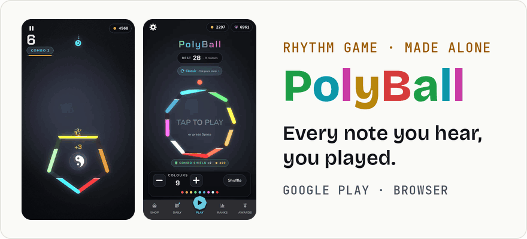
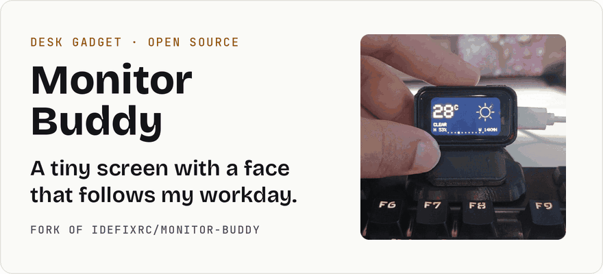
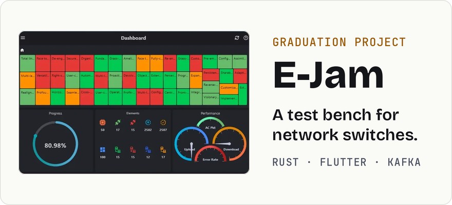
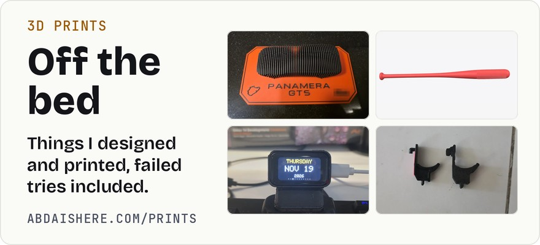

<a href="https://abdaishere.com">
<picture>
  <source media="(prefers-color-scheme: dark)" srcset="readme/banner-dark.svg">
  
</picture>
</a>

<a href="https://abdaishere.com"><picture><source media="(prefers-color-scheme: dark)" srcset="readme/btn-site-dark.svg"></picture></a>
<a href="https://abdaishere.com/polyball/play/"><picture><source media="(prefers-color-scheme: dark)" srcset="readme/btn-play-dark.svg"></picture></a>
<a href="https://www.linkedin.com/in/abdallahelbelkasy"><picture><source media="(prefers-color-scheme: dark)" srcset="readme/btn-linkedin-dark.svg"></picture></a>

<b>Software engineer at Odoo in Dubai. I plan first, then code.</b> That got my game onto Google Play. My 3D printer hasn't read the plan.

<picture>
  <source media="(prefers-color-scheme: dark)" srcset="readme/numbers-dark.svg">
  
</picture>

## Day job

**Software Engineer at Odoo, Dubai.** April 2025 to now. Star of the Month in July 2026.

I work with the client to find out what the business actually needs, map it to what Odoo already does, and write the data model and the delivery plan before the code. Custom code only where it's needed. Python and PostgreSQL, on 100+ client projects across the Gulf, mostly stock and accounting.

- **Stock aging.** I designed and built the first version of a stock aging layer. The report used to walk the whole stock list on every render. Now it renders in under a second.
- **Billing for a logistics client.** The biggest system I've built: postpaid billing for storage and handling, prepaid for rented floor space. It arrived as a vague request, so I cut it into small pieces and agreed each one with the client.
- **Other people's code.** I review partner developers' code against Odoo's standards, and I've coached two partners.

## Currently

- Building a multi-step approval system where requests go back and forth between steps. On purpose.
- Mapping an integration between Odoo and two very large external systems. About 150 hours of it.
- Monitor Buddy, my desk screen, is open source now.

## Things I built

<a href="https://abdaishere.com/polyball/play/"><picture><source media="(prefers-color-scheme: dark)" srcset="readme/card-polyball-dark.gif"></picture></a>

I designed, built and released it alone. It's been on Google Play since 13 November 2026, and it runs in the browser with nothing to install.

- **A synthesiser, not a soundtrack.** Every note is played at runtime: 16 instruments, up to 12 notes at once.
- **Leaderboard** on Supabase (PostgreSQL), with a monthly cup and anti-cheat on the server.
- **GitHub Actions** builds six targets, and bots play 24 runs per pass with deliberate mistakes.
- **15 languages**, with the Arabic right-to-left layout covered by tests.

**[Play it in your browser](https://abdaishere.com/polyball/play/)** · [Google Play](https://play.google.com/store/apps/details?id=com.polyball.game) · [How it's built](https://abdaishere.com/polyball/) · The source is private.

 

<a href="https://github.com/Abdaishere/monitor-buddy"><picture><source media="(prefers-color-scheme: dark)" srcset="readme/card-monitor-buddy-dark.gif"></picture></a>

It goes red when CI fails, says ON AIR while the mic is on, and chews during lunch. It's a fork of [IdefixRC's Monitor-Buddy](https://github.com/IdefixRC/Monitor-Buddy): the base firmware and most of the installer are their work. I added the personalisation, a laptop app, and a simulator: the real firmware running on a PC, where a whole workday passes in seconds. The keyboard dock came off my printer.

[Repository](https://github.com/Abdaishere/monitor-buddy) (MIT) · [The write-up](https://abdaishere.com/prints/monitor-buddy/)

 

<a href="https://github.com/Abdaishere/E-Jam"><picture><source media="(prefers-color-scheme: dark)" srcset="readme/card-e-jam-dark.jpg"></picture></a>

It runs RFC 2544 and RFC 2889 benchmarks. My graduation project at Cairo University, built with Siemens EDA, whose engineers were our mentors, sponsor and product owner. Five of us built it.

I wrote Center Point, the control plane, in Rust on Actix Web: a REST API that moves every stream, device and process through explicit state machines and reads the test statistics from Apache Kafka. I also built the Flutter admin client, the dashboard in the picture. 256 commits, the most on the team.

[Repository](https://github.com/Abdaishere/E-Jam) (MIT) · [Project page](https://abdaishere.com/e-jam/)

 

<a href="https://abdaishere.com/prints/"><picture><source media="(prefers-color-scheme: dark)" srcset="readme/card-prints-dark.jpg"></picture></a>

My 3D prints live on [abdaishere.com](https://abdaishere.com), my site, which I designed and built in plain HTML, CSS and JavaScript, no framework. It also holds my CV and the project pages. So far off the printer: [a life-size baseball bat](https://abdaishere.com/prints/bat/), [a sliced Panamera](https://abdaishere.com/prints/panamera-sculpture/), [gel blaster parts from phone photos](https://abdaishere.com/prints/blaster/) and Monitor Buddy's dock, built on IdefixRC's holder.

[abdaishere.com](https://abdaishere.com) · [Site source](https://github.com/Abdaishere/abdaishere.github.io)

## Tools

`Python` `PostgreSQL` `Odoo ORM` `JavaScript (OWL)` `Rust` `Actix Web` `Apache Kafka` `Flutter` `Dart` `Godot` `Supabase` `Docker` `GitHub Actions` `Linux`

 

<picture>
  <source media="(prefers-color-scheme: dark)" srcset="https://raw.githubusercontent.com/Abdaishere/Abdaishere/output/github-snake-dark.svg">
  
</picture>

My contribution graph, eaten daily by a snake. It's a GitHub Action; I just feed it commits.

<a href="https://abdaishere.com">abdaishere.com</a> · <a href="https://www.linkedin.com/in/abdallahelbelkasy">LinkedIn</a>

