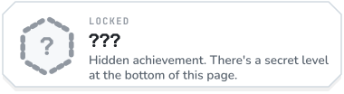

<a href="https://abdaishere.com"><picture><source media="(prefers-color-scheme: dark)" srcset="readme/header-dark.svg"></picture></a>

<p align="center">
<a href="https://abdaishere.com/polyball/play/"><picture><source media="(prefers-color-scheme: dark)" srcset="readme/btn-play-dark.svg"></picture></a>
<a href="https://abdaishere.com"><picture><source media="(prefers-color-scheme: dark)" srcset="readme/btn-site-dark.svg"></picture></a>
<a href="https://www.linkedin.com/in/abdallahelbelkasy"><picture><source media="(prefers-color-scheme: dark)" srcset="readme/btn-linkedin-dark.svg"></picture></a>
</p>

<p align="center"><b>This is where I play.</b> Games, desk gadgets, 3D prints and open source.<br>Up there is a run of PolyBall, the game I made. It's better with sound.</p>

## Achievements

<p align="center">
<picture><source media="(prefers-color-scheme: dark)" srcset="readme/ach-shipped-dark.svg"></picture>
<picture><source media="(prefers-color-scheme: dark)" srcset="readme/ach-nomusic-dark.svg"></picture>
<picture><source media="(prefers-color-scheme: dark)" srcset="readme/ach-bots-dark.svg"></picture>
<picture><source media="(prefers-color-scheme: dark)" srcset="readme/ach-polyglot-dark.svg"></picture>
<picture><source media="(prefers-color-scheme: dark)" srcset="readme/ach-commits-dark.svg"></picture>
<picture><source media="(prefers-color-scheme: dark)" srcset="readme/ach-mit-dark.svg"></picture>
<picture><source media="(prefers-color-scheme: dark)" srcset="readme/ach-bat-dark.svg"></picture>
<picture><source media="(prefers-color-scheme: dark)" srcset="readme/ach-hidden-dark.svg"></picture>
</p>

## Patch notes

```diff
@@ lately @@
+ PolyBall on Google Play,
+ 13 Nov 2026. 19 releases in.
+ Monitor Buddy went public.
+ Web boot: 9.2 s to 5.7 s.
+ Windows build: 32 MB lighter.
- Every music file in PolyBall.
- There were never any.
```

## Side quests

<a href="https://abdaishere.com/polyball/play/"></a>

I designed, built and released it alone. It's been on Google Play since 13 November 2026, and it runs in the browser with nothing to install.

- **Played live, never recorded.** Every note is played at runtime: 16 instruments, up to 12 notes at once.
- **Leaderboard** on Supabase (PostgreSQL), with a monthly cup and anti-cheat on the server.
- **GitHub Actions** builds six targets, and bots play 24 runs per pass with deliberate mistakes.
- **15 languages**, with the Arabic right-to-left layout covered by tests.

**[Play it in your browser](https://abdaishere.com/polyball/play/)** · [Google Play](https://play.google.com/store/apps/details?id=com.polyball.game) · [How it's built](https://abdaishere.com/polyball/) · The source is private.

<br>

<a href="https://github.com/Abdaishere/monitor-buddy"></a>

It goes red when CI fails, says ON AIR while the mic is on, and chews during lunch. It's a fork of [IdefixRC's Monitor-Buddy](https://github.com/IdefixRC/Monitor-Buddy): the base firmware, the web flasher and the printed holder are theirs. I added the desk features (CI, calls, calendar, lunch), a laptop app, and a simulator: the real firmware running on a PC, where a whole day at the desk passes in seconds. My keyboard dock, built on their holder, came off my printer.

[Repository](https://github.com/Abdaishere/monitor-buddy) (MIT) · [The write-up](https://abdaishere.com/prints/monitor-buddy/)

<br>

<a href="https://github.com/Abdaishere/E-Jam"></a>

It runs RFC 2544 and RFC 2889 benchmarks. My graduation project at Cairo University, built in collaboration with Siemens EDA, whose engineers were our mentors, sponsor and product owner. Five of us built it.

I wrote Center Point, the control plane, in Rust on Actix Web: a REST API that moves every stream, device and process through explicit state machines and reads the test statistics from Apache Kafka. The strip on the card is one stream's trip. I also built the Flutter admin app, the dashboard in the picture. 256 commits, the most on the team.

[Repository](https://github.com/Abdaishere/E-Jam) (MIT) · [Project page](https://abdaishere.com/e-jam/)

<br>

<a href="https://abdaishere.com/prints/"></a>

My 3D prints live on [abdaishere.com](https://abdaishere.com), my site, which I designed and built in HTML, CSS and JavaScript, no framework. So far off the printer: [a life-size baseball bat](https://abdaishere.com/prints/bat/), [a sliced Panamera](https://abdaishere.com/prints/panamera-sculpture/), [gel blaster parts from phone photos](https://abdaishere.com/prints/blaster/) and Monitor Buddy's dock, built on IdefixRC's holder.

[abdaishere.com](https://abdaishere.com) · [All the prints](https://abdaishere.com/prints/)

## Inventory

`Python` `PostgreSQL` `JavaScript` `HTML` `CSS` `Rust` `Actix Web` `Apache Kafka` `Flutter` `Dart` `Godot` `Supabase` `Docker` `GitHub Actions` `Playwright` `Linux`

<details>
<summary><b>Secret level</b></summary>
<br>

```gcode
; abdallah.gcode, a profile, sliced
M190 S60         ; wait for the bed
M109 S215        ; wait for the nozzle
G28              ; home: Dubai
G29              ; level the bed. Then level the idea.
G1 Z0.2 F600     ; first layer: a sketch on paper
G1 X120 E6       ; then a prototype, ugly on purpose
M0               ; pause to admire it
M300 S523 P150   ; C
M300 S659 P150   ; E
M300 S784 P300   ; G. Every note you hear, you played.
M117 Done          ; one baseball bat, life-size.
M84              ; motors off
```

Achievement unlocked. That's all of them.

</details>

<br>

<picture>
  <source media="(prefers-color-scheme: dark)" srcset="https://raw.githubusercontent.com/Abdaishere/Abdaishere/output/github-snake-dark.svg">
  
</picture>

<p align="center"><sub>My contribution graph, eaten daily by a snake. It's a GitHub Action; I just feed it commits.</sub></p>

<p align="center"><picture><source media="(prefers-color-scheme: dark)" srcset="readme/continue-dark.svg"></picture></p>

<p align="center"><a href="https://abdaishere.com">abdaishere.com</a> · <a href="https://www.linkedin.com/in/abdallahelbelkasy">LinkedIn</a> · <a href="https://abdaishere.com/polyball/play/">Play PolyBall</a></p>
