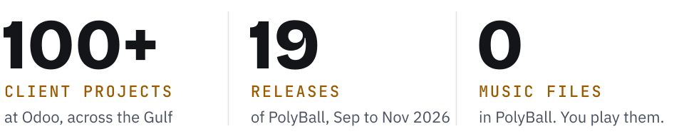
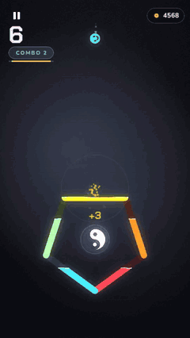
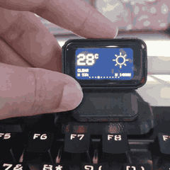
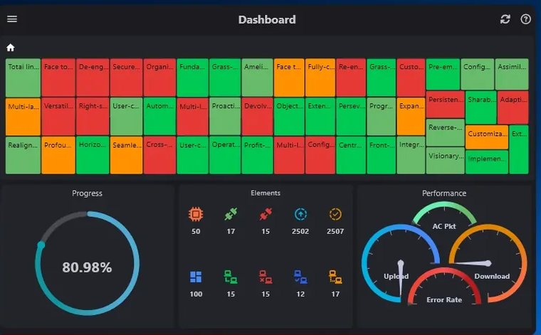
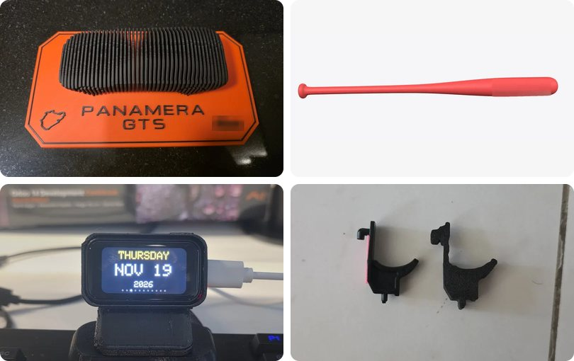

<a href="https://abdaishere.com">
<picture>
  <source media="(prefers-color-scheme: dark)" srcset="readme/banner-dark.svg">
  
</picture>
</a>

<a href="https://abdaishere.com"><picture><source media="(prefers-color-scheme: dark)" srcset="readme/btn-site-dark.svg"></picture></a>
<a href="https://abdaishere.com/polyball/play/"><picture><source media="(prefers-color-scheme: dark)" srcset="readme/btn-play-dark.svg"></picture></a>
<a href="https://www.linkedin.com/in/abdallahelbelkasy"><picture><source media="(prefers-color-scheme: dark)" srcset="readme/btn-linkedin-dark.svg"></picture></a>

<b>Plan first, then code.</b> It works at Odoo, it got a game onto Google Play, and it mostly works on my 3D printer.

<picture>
  <source media="(prefers-color-scheme: dark)" srcset="readme/numbers-dark.svg">
  
</picture>

## Day job

**Software Engineer at Odoo, Dubai.** April 2025 to now. Star of the Month in July 2026.

I work with the client to find out what the business actually needs, map it to what Odoo already does, and write the data model and the delivery plan before the code. Custom code only where it's needed. Python and PostgreSQL, on 100+ client projects across the Gulf, mostly stock and accounting.

- **Stock aging.** I designed and built the first version of a stock aging layer. The report used to walk the whole stock list on every render. Now it renders in under a second.
- **Billing for a logistics client.** The biggest system I've built: postpaid billing for storage and handling, prepaid for rented floor space. It arrived as a vague request, so I cut it into small pieces and agreed each one with the client.
- **Other people's code.** I review partner developers' code against Odoo's standards, and I've coached two partners.

## Currently

- Building a multi-step approval system where requests go back and forth between steps. On purpose.
- Mapping an integration between Odoo and two very large external systems. About 150 hours of it.
- Monitor Buddy, my desk screen, is open source now. It started as a fork, so fork away.

## Things I built

### PolyBall

**A rhythm game where every note you hear, you played.** Catch the ball on its colour and the music builds, one note at a time. Miss once and it all stops.

I designed, built and released it alone. It's been on Google Play since 13 November 2026, and it runs in the browser with nothing to install.

- **No music files.** A synthesiser plays every note at runtime: 16 instruments, up to 12 notes at once.
- **Leaderboard** on Supabase (PostgreSQL), with a monthly cup and anti-cheat on the server.
- **GitHub Actions** builds six targets, and bots play 24 runs per pass with deliberate mistakes.
- **15 languages**, with the Arabic right-to-left layout covered by tests.

**[Play it in your browser](https://abdaishere.com/polyball/play/)** · [Google Play](https://play.google.com/store/apps/details?id=com.polyball.game) · [How it's built](https://abdaishere.com/polyball/) · The source is private.

 

### Monitor Buddy

**A tiny desk screen with a face that follows my workday.** It goes red when CI fails, says ON AIR while the mic is on, and chews during lunch.

It's a fork of [IdefixRC's Monitor-Buddy](https://github.com/IdefixRC/Monitor-Buddy): the base firmware and most of the installer are their work. I added the personalisation, a laptop app, and a simulator that runs the real firmware in the browser, so you see a change before it reaches the board. The keyboard dock came off my printer.

[Repository](https://github.com/Abdaishere/monitor-buddy) (MIT) · [The write-up](https://abdaishere.com/prints/monitor-buddy/)

 

### E-Jam

**A distributed test bench for network switches.** It runs RFC 2544 and RFC 2889 benchmarks. My graduation project at Cairo University, built with Siemens EDA, whose engineers were our mentors, sponsor and product owner.

Five of us built it. I wrote Center Point, the control plane, in Rust on Actix Web: a REST API that moves every stream, device and process through explicit state machines and reads the test statistics from Apache Kafka. I also built the Flutter admin client you see here. 256 commits, the most on the team.

[Repository](https://github.com/Abdaishere/E-Jam) (MIT) · [Project page](https://abdaishere.com/e-jam/)

 

### abdaishere.com and the 3D prints

<a href="https://abdaishere.com/prints/"><picture><source media="(prefers-color-scheme: dark)" srcset="readme/prints-dark.jpg"></picture></a>

My site, designed and built by me in plain HTML, CSS and JavaScript, no framework. It holds the CV, the project pages and **Off the bed**, where I write up the things I design and print, failed tries included.

So far: [a life-size bat on a 30 cm printer](https://abdaishere.com/prints/bat/), [a Panamera in 44 slices](https://abdaishere.com/prints/panamera-sculpture/), [gel blaster parts from phone photos](https://abdaishere.com/prints/blaster/) and Monitor Buddy's dock.

[abdaishere.com](https://abdaishere.com) · [Site source](https://github.com/Abdaishere/abdaishere.github.io)

 

## Tools

`Python` `PostgreSQL` `Odoo ORM` `JavaScript (OWL)` `Rust` `Actix Web` `Apache Kafka` `Flutter` `Dart` `Godot` `Supabase` `Docker` `GitHub Actions` `Linux`

 

<picture>
  <source media="(prefers-color-scheme: dark)" srcset="https://raw.githubusercontent.com/Abdaishere/Abdaishere/output/github-snake-dark.svg">
  
</picture>

My contribution graph, eaten daily by a snake. It's a GitHub Action; I just feed it commits.

